<div align="center">



<br/>

[](https://adityahasija.vercel.app/) [](https://www.linkedin.com/in/adityahasija/) [](mailto:adityahasija37@gmail.com)

</div>

---

## 👋 The 6-second version

| | Aditya, at a glance |
|---|---|
| **What I do** | Product management for B2B SaaS, fintech and AI products. Discovery → PRD → roadmap → launch → adoption. |
| **Where I've done it** | **BDO** (Product Manager - Associate) · **Expenzing** (Product Specialist) · **Massey Services** (Product Analyst Co-op) |
| **What I'm good at** | Turning dense domains like tax, procurement and field operations into specs engineers can build and metrics leadership can trust |
| **Unfair advantage** | Engineering degree, and I ship working products with AI coding tools. Both projects below have a PRD, metrics plan and live demo |
| **Right now** | MS in Information Systems at Northeastern, graduating **Dec 2026**. Looking for **PM / AI PM / APM / Product Analyst / Business Analyst** roles |

## 📈 Impact dashboard



## 🚀 Shipped in public

> Side projects run like real products: spec first, evidence-gated releases, and an honest "what's unproven" section. Click a demo, no sign-up needed.

<table>
<tr>
<td width="50%" valign="top">

### ⚽ [Touchline](https://github.com/AdityaHasija37/touchline)

<a href="https://touchline-olive-six.vercel.app"></a>

**Match prep for grassroots football captains.** Squad, lineup, set pieces, fair minutes, and one briefing where every player taps *Find me* to see their job.

- **The bet:** the gap isn't drawing tactics, it's *continuity* from squad to a briefing players actually open
- **Release 1.2**, shipped in evidence-gated phases
- **311 tests** across unit, database and end-to-end, plus WCAG 2.2 AA checks

📄 [Case study](https://github.com/AdityaHasija37/touchline/blob/main/docs/product/CASE-STUDY.md) · [PR-FAQ](https://github.com/AdityaHasija37/touchline/blob/main/docs/product/PRFAQ.md) · [PRD](https://github.com/AdityaHasija37/touchline/blob/main/docs/product/PRD.md) · [Metrics](https://github.com/AdityaHasija37/touchline/blob/main/docs/product/METRICS.md) · [UX audit](https://github.com/AdityaHasija37/touchline/blob/main/docs/design/UX-AUDIT.md)

[](https://touchline-olive-six.vercel.app)

</td>
<td width="50%" valign="top">

### 🧴 [Sillage](https://github.com/AdityaHasija37/sillage)

<a href="https://sillage-rosy.vercel.app"></a>

**A fragrance app with a grounded AI agent.** Collection score, daily pick, layering lab, explained recommendations and exact-bottle price checks.

- **AI design:** one agent, ten typed tools. The model plans and explains, tested code ranks
- **Evals written before the first run:** 0 of 7 planted fakes reached users
- **100% precision** on exact-bottle price matching (up from 83%) on 61 adversarial listings

📄 [Case study](https://github.com/AdityaHasija37/sillage/blob/main/docs/product/CASE-STUDY.md) · [One-pager](https://github.com/AdityaHasija37/sillage/blob/main/docs/product/ONE-PAGER.md) · [PRD](https://github.com/AdityaHasija37/sillage/blob/main/docs/product/PRD.md) · [Metrics](https://github.com/AdityaHasija37/sillage/blob/main/docs/product/METRICS.md) · [Public evals](https://sillage-rosy.vercel.app/evals)

[](https://sillage-rosy.vercel.app)

</td>
</tr>
</table>

<sub>Also on here: <a href="https://github.com/AdityaHasija37/SkillPort">SkillPort</a> (learning platform I built solo: React, Node, MongoDB, JWT) · <a href="https://github.com/AdityaHasija37/CampusCrib">CampusCrib</a> (multi-role student housing platform, team of 3, Java + MySQL) · <a href="https://github.com/AdityaHasija37/Workship">WorkShip</a> (requirements, user flows and hi-fi wireframes, team of 5)</sub>

## 🗒️ Changelog

> My career, written the way I write release notes.

```diff
## v3.0 · Massey Services · Product Analyst Co-op · Jul – Dec 2025
+ Led discovery and pilot of digital property graphing: ~25% higher sales vs. manual graphing
+ Evaluated 5 tools on 8 criteria across 4 service lines, with ride-alongs alongside field crews
+ Built e-commerce cart and purchase flows across 3 API integrations: ~20% less checkout friction
```

```diff
## v2.0 · BDO · Product Manager - Associate · Oct 2022 – Aug 2024
+ Owned roadmaps for 5 Tax & Finance SaaS products and shipped 90% of what we committed
+ Revived a shelved Tax SaaS as Product Owner (roadmap, APIs, GTM): ~$80K first-phase revenue
+ Launched 3 LLM-powered features with data science & ML: 42% weekly adoption within 2 months
+ Took a vendor compliance & AP automation product 0→1: ~40% of procurement workflow automated
+ Ran 40+ discovery interviews; improved on-time delivery 17% and cut time-to-market 15%
```

```diff
## v1.0 · Expenzing · Product Specialist · Jun 2021 – Sep 2022
+ Implemented Procure-to-Pay, T&E and Sourcing for 8 BFSI clients: 15% faster onboarding
+ Delivered 25+ change requests from PRD to UAT at 95% client satisfaction
+ Found 30+ usability fixes in a Procure-to-Pay UX revamp; training & docs cut tickets 30%
```

```diff
## v4.0 · Your team · Coming soon
+ Graduating with an MS in Information Systems from Northeastern, Dec 2026
! Status: looking for the right product team. Release date depends on you
```

## 🧠 How I work

| Principle | What it looks like in practice |
|---|---|
| 🎙️ **Users before roadmaps** | 40+ interviews at BDO. Ride-alongs with field crews at Massey to see the work firsthand |
| 📝 **Specs before code** | Touchline and Sillage both started from a written PRD, not a blank editor |
| 🧪 **Evals before launch** | For AI features I define guardrails, eval criteria and human review steps up front, at BDO and in Sillage |
| 📊 **Adoption over launches** | I set up usage tracking with the feature, not after it. Shipping is the start of the measurement |
| 🚩 **Say what's unproven** | My project READMEs list what I haven't validated yet. Touchline's discovery plan comes with kill criteria |

## 🧰 Toolbox

**Discover & define** &nbsp;     

**Measure & decide** &nbsp;      

**Deliver** &nbsp;    

**Build & prototype** &nbsp;      

## ❓ PR-FAQ for hiring managers

<details>
<summary><b>What roles are you looking for?</b></summary>
<br/>

Full-time **Product Manager, AI Product Manager, Associate PM, Product Analyst and Business Analyst** roles, especially B2B SaaS, fintech and AI products. I graduate in December 2026.
</details>

<details>
<summary><b>You have an engineering degree and you write code. Are you a PM or an engineer?</b></summary>
<br/>

A PM. The engineering background means I can write API specs, test endpoints, query the data myself and build a working prototype to settle a debate. On Touchline and Sillage an AI coding agent did the engineering; every product call was mine.
</details>

<details>
<summary><b>What's your experience with AI products?</b></summary>
<br/>

At BDO I partnered with data scientists and ML engineers on 3 LLM-powered features: requirements, use cases, guardrails, evals, human review steps and usage tracking. They reached 42% weekly adoption within 2 months. Sillage is my public version of that work: a grounded agent where a model can't show users anything a tool didn't return, with evals you can read.
</details>

<details>
<summary><b>What do people who worked with you say?</b></summary>
<br/>

My manager in Product Strategy at BDO pointed to my ownership and initiative in improving the product suite. Our dev lead said I turn complex requirements into actionable solutions and explain them well to cross-functional teams. Both recommendations are on [LinkedIn](https://www.linkedin.com/in/adityahasija/).
</details>

<details>
<summary><b>What's the fastest way to evaluate you?</b></summary>
<br/>

**2 min:** click either live demo above. **5 min:** read the [Touchline case study](https://github.com/AdityaHasija37/touchline/blob/main/docs/product/CASE-STUDY.md). **15 min:** [book a chat](mailto:adityahasija37@gmail.com?subject=Let's%20talk%20product) and ask me about the decisions.
</details>

<br/>

<div align="center">



**[Portfolio](https://adityahasija.vercel.app/)** · **[LinkedIn](https://www.linkedin.com/in/adityahasija/)** · **[adityahasija37@gmail.com](mailto:adityahasija37@gmail.com)**

</div>

